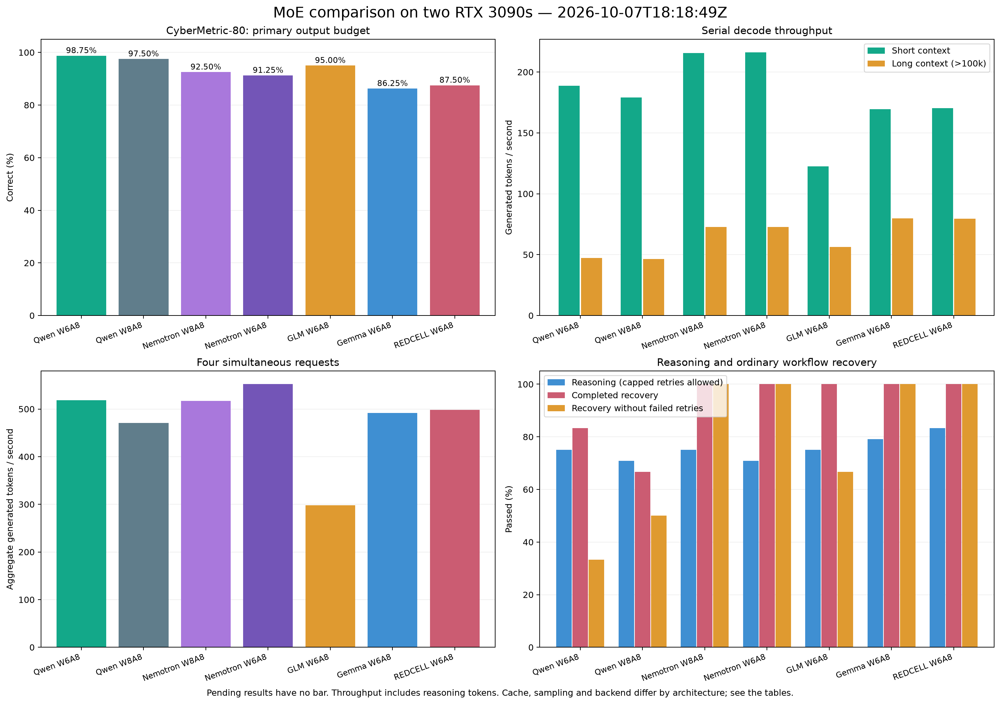

# RTX 3090 MoE evaluation

Updated: 2026-10-07T18:18:49Z. Hardware: 2 x RTX 3090 24 GiB, NVLink; 125 GiB system RAM. vLLM 0.31.0.

**Running choice: redcell. Boot enabled: True.**
The decision and exact preference weights are below. These small local tests support a deployment choice; they do not prove broad intelligence or practical offensive-security capability.

Smart and fast enough to use wins. Reasoning, correct consistency, tool recovery, and cybersecurity knowledge drive the decision. Speed is a usability check. Kali workflows are excluded at the owner’s request.



## Accuracy and consistency

| Model | Cyber primary / retry | Policy first / clarified | Long-context checks | Reasoning first / retry | All repeats correct, first / retry | Recovery |
|---|---|---|---|---|---|---|
| Qwen Hauhau W6A8 | 79/80 / 79/80 | 27/43 / 32/43 | 47/54 | 16/24 / 18/24 | 4/8 / 6/8 | 5/6 |
| Qwen Hauhau W8A8 | 78/80 / 78/80 | 23/43 / 26/43 | 42/54 | 17/24 / 17/24 | 5/8 / 5/8 | 4/6 |
| Nemotron Heretic W8A8 | 74/80 / 76/80 | 12/43 / 16/43 | 46/54 | 16/24 / 18/24 | 4/8 / 5/8 | 6/6 |
| Nemotron Heretic W6A8 | 73/80 / 75/80 | 16/43 / 4/43 | 39/54 | 16/24 / 17/24 | 4/8 / 5/8 | 6/6 |
| GLM Hauhau W6A8 | 76/80 / 78/80 | 23/43 / 17/43 | 53/54 | 18/24 / 18/24 | 6/8 / 6/8 | 6/6 |
| Gemma Hauhau W6A8 | 69/80 / 76/80 | 20/43 / 42/43 | 52/54 | 17/24 / 19/24 | 5/8 / 6/8 | 6/6 |
| REDCELL W6A8 | 70/80 / 73/80 | 30/43 / 43/43 | 53/54 | 14/24 / 20/24 | 3/8 / 6/8 | 6/6 |

## Tools and recovery behavior

| Model | Native API checks | Metadata fields | Strict JSON metadata cases | Claude Code Read | Extra failed-tool attempts |
|---|---|---|---|---|---:|
| Qwen Hauhau W6A8 | 7/7 | 20/20 | 3/4 | pass, 2.4 s | 8 |
| Qwen Hauhau W8A8 | 7/7 | 20/20 | 4/4 | pass, 3.2 s | 12 |
| Nemotron Heretic W8A8 | 6/6 | 20/20 | 4/4 | pass, 4.2 s | 0 |
| Nemotron Heretic W6A8 | 6/6 | 20/20 | 4/4 | pass, 4.6 s | 0 |
| GLM Hauhau W6A8 | 6/6 | 20/20 | 2/4 | pass, 5.0 s | 4 |
| Gemma Hauhau W6A8 | 7/7 | 19/20 | 4/4 | pass, 6.4 s | 0 |
| REDCELL W6A8 | 7/7 | 20/20 | 4/4 | pass, 2.8 s | 0 |

## Throughput and configuration

| Model | Short tokens/s | Long tokens/s | Four-request aggregate | KV cache | Context limit |
|---|---:|---:|---:|---|---:|
| Qwen Hauhau W6A8 | 188.8 | 47.3 | 518.6 | turboquant_4bit_nc | 200000 |
| Qwen Hauhau W8A8 | 179.2 | 46.4 | 470.6 | turboquant_4bit_nc | 200000 |
| Nemotron Heretic W8A8 | 215.6 | 72.8 | 517.3 | turboquant_4bit_nc | 200000 |
| Nemotron Heretic W6A8 | 216.1 | 72.7 | 552.0 | turboquant_4bit_nc | 200000 |
| GLM Hauhau W6A8 | 122.5 | 56.2 | 297.7 | bfloat16 | 147456 |
| Gemma Hauhau W6A8 | 169.5 | 79.9 | 491.9 | bfloat16 | 200000 |
| REDCELL W6A8 | 170.3 | 79.6 | 498.3 | bfloat16 | 200000 |

## GPU memory and full-context capacity

| Model | Loaded model GiB/card | GPU cache capacity, tokens | Capacity / configured full context |
|---|---:|---:|---:|
| Qwen Hauhau W6A8 | 13.6 | 2352727 | 11.8 |
| Qwen Hauhau W8A8 | 17.3 | 741818 | 3.7 |
| Nemotron Heretic W8A8 | 15.2 | 4017647 | 20.1 |
| Nemotron Heretic W6A8 | 14.1 | 5800000 | 29.0 |
| GLM Hauhau W6A8 | 11.3 | 168096 | 1.1 |
| Gemma Hauhau W6A8 | 12.3 | 216565 | 1.1 |
| REDCELL W6A8 | 12.3 | 216565 | 1.1 |

The capacity ratio is the startup cache estimate, not a measured simultaneous-request guarantee. Eight short API calls and four-request throughput do not establish eight simultaneous 200k-token sessions. Host KV offload stores cached prefixes; it does not make all long active contexts resident on the GPUs.


## What completed

- **Qwen Hauhau W6A8**: suite completed; all test programs succeeded; reasoning/recovery completed.
- **Qwen Hauhau W8A8**: suite completed; all test programs succeeded; reasoning/recovery completed.
- **Nemotron Heretic W8A8**: suite completed; all test programs succeeded; reasoning/recovery completed.
- **Nemotron Heretic W6A8**: suite completed; all test programs succeeded; reasoning/recovery completed.
- **GLM Hauhau W6A8**: suite completed; all test programs succeeded; reasoning/recovery completed.
- **Gemma Hauhau W6A8**: suite completed; all test programs succeeded; reasoning/recovery completed.
- **REDCELL W6A8**: suite completed; all test programs succeeded; reasoning/recovery completed.

## Six bits on a 3090? Hell yes. >:)

I wanted six-bit weights without turning the model into a damn potato. Humming stores the weights in a dense six-bit format and unpacks them for the 3090’s INT8 matrix operations. There is no native six-bit Tensor Core instruction hiding in these cards. We pay for unpacking and scales, and the timings include that cost.

W6A8 means six-bit stored weights and dynamic eight-bit activations in eligible quantized linears. BF16 remains the surrounding dtype and the precision for sensitive or unquantized components. Q4 TurboQuant is a separate KV-cache setting where the architecture supports it.

The matched Hauhau deployment used **20.83% less checkpoint storage** than W8A8. Short decode changed **+5.33%**, long decode **+1.87%**, and four-request aggregate **+10.19%**.

That is useful efficiency on this setup. Accuracy still decides which model runs. These kernels and weight scales differ between precisions, so this is a comparison of the complete deployments. Small score differences are not proof that six bits universally improves accuracy. See [the matched measurements](results/precision-comparison.json).

## Earlier Endy and W8A16 comparisons

Historical runs used earlier serving profiles and are not matched to the final full round. Hauhau W8A8 variation is retained to avoid claiming small quantization score changes are universal. Endy failed the custom metadata tool workflows despite functional Claude Code Read.

| Earlier configuration | Long-context checks | Strict JSON turns | Metadata tool calls | Long decode tokens/s | Policy first / clarified |
|---|---|---|---:|---:|---|
| Endy W8A8 | 27/54 | 0/8 | 0 | 47.5 | not measured here |
| Endy W8A16 | 46/54 | 0/8 | 0 | 47.5 | not measured here |
| Hauhau W8A16 | 53/54 | 7/8 | 2 | 47.3 | 28/43 / 36/43 |
| Hauhau W8A8 (earlier run) | 53/54 | 7/8 | 2 | 46.9 | 30/43 / 34/43 |

The earlier complete model archive and restore information are [public on Hugging Face](https://huggingface.co/Xananthium/Inference-Model-Archive-2026-10). OLMoE was removed from the active comparison at the owner’s request.


## Model sources and public checkpoints

- **Qwen Hauhau W6A8**: [source](https://huggingface.co/HauhauCS/Qwen3.6-35B-A3B-Uncensored-HauhauCS-Aggressive), [tested checkpoint](https://huggingface.co/Xananthium/Qwen3.6-35B-A3B-Hauhau-Aggressive-W6A8-Vision)
- **Qwen Hauhau W8A8**: [source](https://huggingface.co/HauhauCS/Qwen3.6-35B-A3B-Uncensored-HauhauCS-Aggressive), [tested checkpoint](https://huggingface.co/Xananthium/Qwen3.6-35B-A3B-Hauhau-Aggressive-W8A8-Vision)
- **Nemotron Heretic W8A8**: [source](https://huggingface.co/trohrbaugh/NVIDIA-Nemotron-3-Nano-30B-A3B-BF16-heretic), [tested checkpoint](https://huggingface.co/Xananthium/NVIDIA-Nemotron-3-Nano-30B-A3B-Heretic-W8A8)
- **Nemotron Heretic W6A8**: [source](https://huggingface.co/trohrbaugh/NVIDIA-Nemotron-3-Nano-30B-A3B-BF16-heretic), [tested checkpoint](https://huggingface.co/Xananthium/NVIDIA-Nemotron-3-Nano-30B-A3B-Heretic-W6A8)
- **GLM Hauhau W6A8**: [source](https://huggingface.co/HauhauCS/GLM-4.7-Flash-Uncensored-HauhauCS-Aggressive), [tested checkpoint](https://huggingface.co/Xananthium/GLM-4.7-Flash-Hauhau-Aggressive-W6A8)
- **Gemma Hauhau W6A8**: [source](https://huggingface.co/HauhauCS/Gemma4-26B-A4B-Uncensored-HauhauCS-Balanced), [tested checkpoint](https://huggingface.co/Xananthium/Gemma4-26B-A4B-Hauhau-Balanced-W6A8-Vision)
- **REDCELL W6A8**: [source](https://huggingface.co/terrorswift/REDCELL-26B-A4B-OSINT-Cyber-APEX-GGUF), [tested checkpoint](https://huggingface.co/Xananthium/REDCELL-26B-A4B-OSINT-Cyber-W6A8-Vision)

## Limits of the comparison

- CyberMetric-80 is a small public knowledge quiz that may overlap training data; the questions are not redistributed.
- Policy and long-context checks are synthetic. Some policy answers describe the vulnerable implementation rather than the recommended change. First answers and clarified answers are reported separately.
- Long-context requests replay eight independent original prefixes; they are not a new eight-turn conversation.
- General reasoning uses eight synthetic exact-answer problems at three controlled OpenAI seeds. Only output-capped responses are retried once at 4096 tokens; primary 2048-token accuracy stays separate. Recovery uses two ordinary catalog/analytics tasks with a failed starting step, sampled three times via native Anthropic.
- Consistency means answering correctly in every repeat; repeatedly giving the same wrong answer is not credited.
- Decode throughput includes thinking tokens. Timing uses two measured serial repetitions and two four-request batches after warmup.
- GLM uses BF16 MLA cache. Gemma/REDCELL use BF16 cache because their selected attention backend rejects TurboQuant in this deployment. Qwen/Nemotron use TurboQuant Q4 where supported.
- W6A8 uses Humming and group scales (128 for Qwen/GLM, 32 for Gemma/REDCELL/Nemotron). W8A8 baseline kernels and per-channel scales differ; this compares deployment configurations.
- Some source GGUFs were already quantized. Restoring to BF16 before conversion does not recover original trained BF16 fidelity.
- Energy per token was not measured. Efficiency claims here concern checkpoint size, observed GPU memory, and timed throughput.
- A successful test process is distinct from all correctness checks passing. Partial runs cannot establish a winner. Raw reasoning, API secrets and private transcripts are excluded.

## Reproduce the short evaluations

Set `API_BASE_URL`, `MODEL`, and `API_KEY` in your environment for a server with OpenAI chat completions and native Anthropic messages. The scripts inherit the server’s sampling configuration and enable thinking. Keep a separate output directory for each model.

```bash
python scripts/test_reasoning_consistency.py --variant my-model --output runs/my-model/reasoning-consistency
python scripts/test_cybermetric.py --dataset /path/to/CyberMetric-80-v1.json --variant my-model --output runs/my-model/cybermetric --retry-truncated
```

Obtain CyberMetric-80-v1 from [the benchmark authors](https://github.com/cybermetric/CyberMetric). The measured dataset SHA is recorded in each result. The question text is not bundled. These portable scripts implement the protocols used for the short knowledge and reasoning/recovery tests; the chart data also includes the separate local long-context and client integration checks.

## Rebuild the charts

```bash
python -m pip install -r requirements.txt
python scripts/build_report.py
```

## Publish to GitHub tomorrow

After creating/logging into the Xananthium GitHub account with the GitHub CLI:

```bash
gh auth login
gh repo create Xananthium/inference-model-evaluation --public --source . --push
```

## Selected deployment

**Selected: redcell.**

- Running: True; start on boot: True.
- Vision available: True.
- Client model alias: `qwen3.6-35b-hauhau-w4a16-vision`.
- Require completed suite, native API and real Claude Code Read, plus usable throughput (25 short-context tokens/s, 15 long-context tokens/s, 80 aggregate across four requests). Choose the highest measured quality: reasoning, correct consistency, tool recovery with a penalty for repeating failed approaches, cybersecurity knowledge and long context. Throughput only breaks an otherwise exact quality tie; W6A8 is not preferred over a smarter model.
- Use accuracy and correct consistency after the single 4096-token retry of output-capped responses; retain the primary 2048-token scores separately.
- This is an explicit deployment preference heuristic, not a standardized overall intelligence or offensive-security score.

| Candidate | Local quality preference score | Short tokens/s | Long tokens/s | Four-request tokens/s |
|---|---:|---:|---:|---:|
| redcell | 89.1% | 170.3 | 79.6 | 498.3 |
| gemma | 87.0% | 169.5 | 79.9 | 491.9 |
| glm | 85.0% | 122.5 | 56.2 | 297.7 |
| nemotron | 82.3% | 215.6 | 72.8 | 517.3 |
| nemotron-w6a8 | 80.2% | 216.1 | 72.7 | 552.0 |
| hauhau-w6a8 | 79.4% | 188.8 | 47.3 | 518.6 |
| hauhau | 72.8% | 179.2 | 46.4 | 470.6 |

Exact components and preference weights are in [summary.json](results/summary.json). The preference score is not a published benchmark score.
